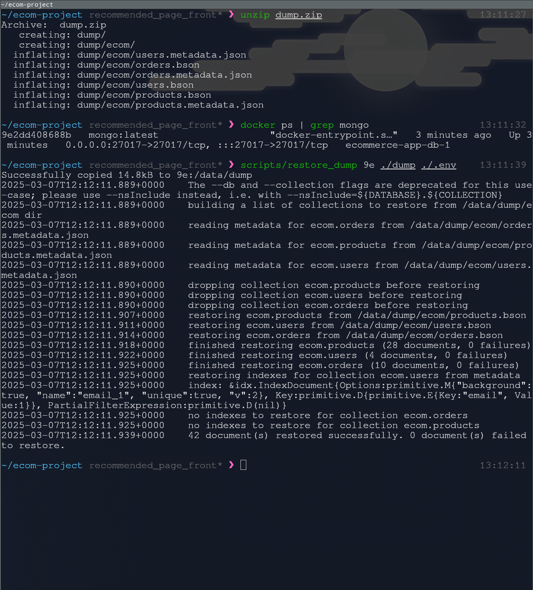

# App and Web Development Module Assignment

This repository contains the code for the App and Web Development Module
Assignment, which is a simple full-stack E-commerce Web App. The provided
`docker-compose.yaml` file allows users to easily set up and run the entire
application stack using Docker Compose. More detailed review will be provided in
the submitted report of this assignment.

UPD: Currently this repo is used for lab works on studying k8s and micro-service
architecture for applications (see [docs](./docs))

## Table of Contents

- [Prerequisites](#pre)
- [Services Summary](#services)
- [Build and Run](#build-and-run)
  - [Troubleshooting](README#Troubleshooting)
  - [Restore Dump](#restore-dump)
  - [Run the tests](#run-the-tests)
- [License](#license)

## Prerequisites<a name="pre"></a>

The following software needs to be installed on your machine:

- [Docker](https://docker.com) + [Docker Compose](https://docs.docker.com/compose/install/linux/)
- [Make](https://gnu.org/software/make)

## Serivces

1. `database` - MongoDB for handling data storage.
1. `backend` - Application Server on Express.js.
1. `frontend` - An SPA written on Angular.js.
1. `webserver` - A Reverse Proxy (NGINX).
1. `cache` - A simple Redis cache service.
1. `recommend` - A recommendation system service (Express.js).
1. `embed` - An embeddings service (Flask + Sentence Transformers + FAISS).

## Build and Run<a name="build-and-run"></a>

1. Clone this repository and navigate to its root.
1. Build and start the Docker containers:

   ```bash
   make build
      ```

   *!!! May take a while.*

1. Once the containers are up and running, you can access the Angular SPA at
   `http://localhost:8080/`.

   You can enter the admin page with
   default credentials:

   ```
   admin@mail.com
   root
   ```

### Troubleshooting

There are possible failures in container starts for `webserver` and `backend`
services. If you face issues like `Bad Gateway` responses, inspect running
containers with `docker ps -a`, and try to re-start failed services:

```bash
docker compose up -d --build <service_name>
```

### Restore Dump

This is completely optional.

The dump included in this repo has slightly more users, and some mock orders.
It was made primarily for the evaluators of on of the university assignments
related to integration of recommendation system into initial minimalistic
e-commerce platform.

In order to restore the db from `dump.zip`:

1. Unpack the `dump.zip` archive into project's root directory.

   *Linux Example using unzip:*
   ```bash
   unzip dump.zip
   ```

1. Run the `restore_dump.sh` script from `sctipts` subdirectory.

   **Important:** The script should be run from this project's root directory.

   To see the usage of the script simply run it with no arguments.

   The next screenshot aims to demonstrate an overview of the whole process:

   

### Run the tests

TODO: Write the section
